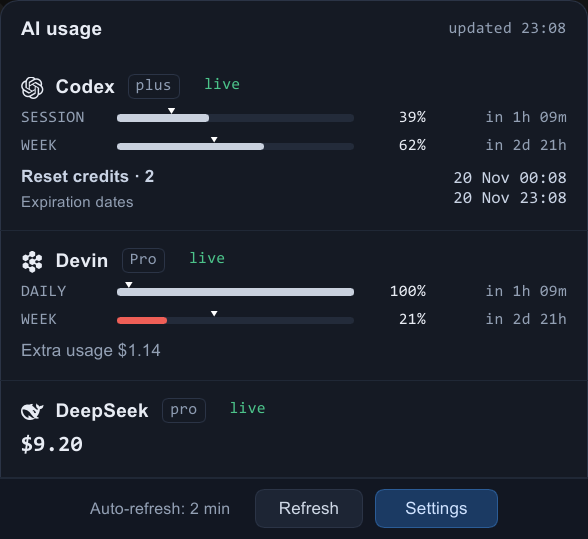

# Taskbar AI Monitor

**AI quota in the Windows taskbar.** Live usage meters for **Codex**, **Devin**
and **DeepSeek** in one compact strip — always in your peripheral vision,
never in the way.

   
  On the taskbar — Codex, Devin and DeepSeek next to the tray

   
  The details flyout — quota windows, pace ticks and reset dates

## Install

Download [`taskbar-ai-monitor-win-Setup.exe`](https://github.com/dosoft/TaskbarAIMonitor/releases/latest/download/taskbar-ai-monitor-win-Setup.exe)
and run it — per-user install, no admin rights, automatic updates.
Windows SmartScreen may warn on the first run because the binary is unsigned:
**More info → Run anyway**.

## Why it exists

Working with AI agents all day means living inside rate limits. Instead of
opening dashboards, the strip keeps session and weekly windows plus balances
right on the taskbar. It toasts when a window crosses your thresholds and
before reset credits expire, and polls faster as resets approach.

And it answers the question that actually matters — not just *how much is
left*, but *will it last*. Each bar does that math at your current pace: a
tick marks where the fill would sit under an even burn, and the bar's colour
is the projected remainder at reset — neutral while the quota should last,
amber through orange to red as the projection slips into deficit.

## Providers

- **Codex** — session and weekly windows, plan badge, reset-credit expiration
  dates and extra usage.
- **Devin** — daily and weekly windows with extra-usage spend.
- **DeepSeek** — balance with colour cues for low funds.

## How it differs

- **~9.4 MB single exe** — Rust + Slint software renderer, no WebView, no .NET,
  no Electron.
- **~29 MiB working set and ~0.05 % CPU idle**, next to ~76–136 MiB for
  comparable taskbar meters.
- **Adaptive polling** — slows down far from resets, speeds up near them;
  threshold and quota-reset toasts.
- **Three widget styles**, details flyout, four settings tabs, autostart,
  per-user install with auto-updates.

---

Releases and the update feed for Taskbar AI Monitor — sources are private.

© 2026 [Oleg Danilov](https://github.com/dosoft) · [MIT License](LICENSE) · [Changelog](CHANGELOG.md)
